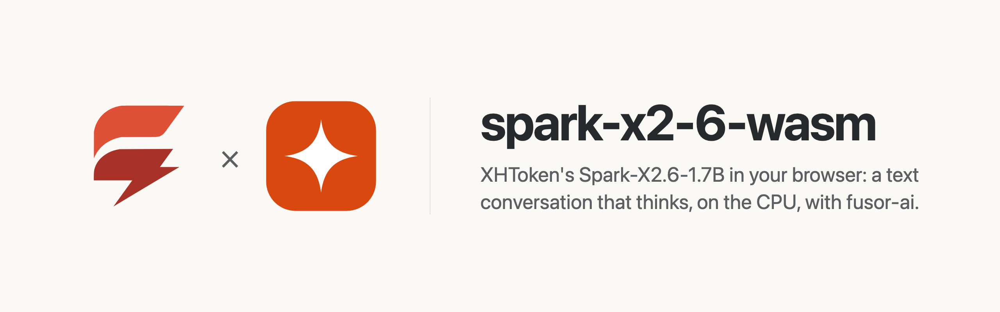

<p>
  <picture>
    <source media="(prefers-color-scheme: dark)" srcset="assets/brand/banner-dark.png">
    
  </picture>
</p>

# A conversation that thinks, in the browser, on the CPU

**[Try it in your browser](https://huggingface.co/spaces/fusorlabs/spark-x2-6-wasm)**: no install, no server. The model downloads once and runs on your CPU.

**Replies written at 91 to 95 tokens a second, each started in 0.10 to 0.24 s**, in headless Chrome on an Apple M4 Pro, eight threads. [How fast is it](#how-fast-is-it)

<a href="https://huggingface.co/spaces/fusorlabs/spark-x2-6-wasm"></a>

Talk to XHToken's [Spark-X2.6-1.7B](https://huggingface.co/XHToken/Spark-X2.6-1.7B), let it reason in a thinking block first or answer straight away, and read each reply as it is written, computed on your own device. No server, no API key, no GPU required, and once the model has loaded, nothing you type leaves the page.

spark-x2-6-wasm is the app around the model: a [fusor](https://github.com/fusor-rs/fusor) page, the browser runtime and a native CLI. The model itself, compiled to WebAssembly, is built with [fusor-ai](https://github.com/fusor-rs/fusor-ai), the toolkit for AI runtimes in Rust and WebAssembly, from the published weights.

**In development · v0.1**: this is experimental software. See [status and known limitations](#status-and-known-limitations).

[Run it](#run-it-locally) · [Try it online](#try-it-online) · [How it works](#how-it-works) · [How fast is it](#how-fast-is-it) · [Status](#status-and-known-limitations)

## Run it locally

You need Rust 1.99 or newer, installed with [rustup](https://rustup.rs), Node.js 22 or newer and [`just`](https://github.com/casey/just). Then:

```sh
git clone --recurse-submodules https://github.com/fusor-rs/spark-x2-6-wasm && cd spark-x2-6-wasm
just ui
```

and open the address it prints. `just ui` installs the pinned tools (the threads toolchain with rustup; wasm-bindgen, binaryen and the fusor CLI into `.tools/`), downloads the checkpoint at a pinned revision (3.4 GB, each file sha256-checked), compiles it into a 1921 MB bundle, builds the four browser runtimes (a few minutes the first time, seconds after) and the page, and serves it on `http://localhost:8787` with the bundle beside it.

Write a message, or start from an example (a question, a puzzle, a haiku), and press **Send**, even while the model is still loading: the message is replied to the moment the model is ready. The reply streams in, its Markdown drawn. **Think before replying** is on by default, as in the model's chat template: the model reasons first in a thinking block, and its reasoning folds away once the answer starts; turn it off for a direct answer. Every later message continues the same conversation until **New conversation**. **Sampling** takes the model card's settings for each turn (a temperature of 1, top-p 0.95, every token kept) or your own temperature, top-p, top-k and presence penalty, and the longest reply. Every reply is measured live: the time from Send to its first token, the tokens written per second, the conversation's tokens and those the turn read, and the network requests since the model loaded, which stay at zero.

## Try it online

Open the Hugging Face Space [fusorlabs/spark-x2-6-wasm](https://huggingface.co/spaces/fusorlabs/spark-x2-6-wasm) in Chrome or Edge. The page downloads the 1921 MB model once and keeps it in the browser's storage, so the next visit loads from this device.

## More ways to run it

### Build everything from source

```sh
just build    # also downloads the checkpoint (3.4 GB, sha256-checked) and compiles the bundle
just serve
```

`CHECKPOINT=<dir>` reuses a checkpoint you already have.

### The CLI

The CLI holds the conversations of a JSON file without a browser, turn by turn:

```sh
target/release/spark-x2-6 chat dist/model fixtures/conversations.json
```

`spark-x2-6 bench` measures each stage on a conversation's first turn and `spark-x2-6 parity` compares every stage with the reference's outputs.

## How it works

- **The reference's prompt, token for token.** Each turn's prompt is the whole conversation as the model's chat template writes it: the template's system instruction, with its thinking effort (`high`, the template's default) when the turn thinks, each earlier reply written back without its reasoning, and the reply's opener with its thinking block open or closed.
- **Every turn reads the whole conversation.** Spark-X2.6's 28 layers attend two ways: every fourth over the whole conversation, the others over a window of its last 512 tokens, each head's output through a gate of its own. Since the template writes a reply back without its reasoning, and the window layers keep only their last rows, each turn reads its prompt again from the first token: a follow-up's first token comes later the longer the conversation.
- **Sampled as the model card says.** Each turn draws its tokens with the model card's temperature, top-p and top-k, from a seed the page draws; a temperature of 0 replies greedily, as the checks do.
- **Quantized.** Every large matrix is 7-bit, 1921 MB against the 3.4 GB bf16 checkpoint; the input embeddings and the output head are one tied matrix, as in the checkpoint.
- **One stage per step.** The engine worker replies in steps (the prompt, then each token) and posts each, so the reply streams and Stop takes effect between steps.
- **Threads and SIMD where the browser has them.** The page picks one of four builds: worker threads when it is cross-origin isolated, relaxed SIMD when the engine supports it, plain SIMD128 everywhere else.
- **Downloaded once, verified always.** The bundle streams in parts, each checked against its BLAKE3 hash, and stays in the browser's origin-private storage, so the next visit loads from this device.
- **Sealed.** The runtime imports no network, storage, clock or entropy capability; fusor-ai's import check proves it on every build. The page counts its network requests while it replies, and the count is zero.

## How fast is it

On an Apple M4 Pro in headless Chrome on eight threads (`web-threaded-relaxed`), a question of 46 prompt tokens starts its reply in 0.10 s and writes 91 tokens a second; a follow-up that thinks first, 117 prompt tokens with the conversation so far, starts in 0.24 s and writes 95 a second; the demo's thinking reply, 300 tokens, starts in 0.20 s and writes 70 a second. A revisit loads the 1921 MB bundle from the browser's storage in 2.0 s. Every fixed reply states the facts it is asked for, and every prompt is the reference's token for token.

These are the figures of one `just e2e` run and one `just demo` run (a fresh profile, other work on the machine); `just bench` breaks a turn down by stage natively.

## Documentation

| Guide | Covers |
| --- | --- |
| [AGENTS.md](AGENTS.md) | The code standard every change follows |

## Status and known limitations

spark-x2-6-wasm is v0.1 and experimental.

| Platform or capability | Status |
| --- | --- |
| Chrome and Edge, threads and relaxed SIMD | Headless Chrome end-to-end check (`just e2e`): send while loading, a conversation with a thinking turn, a second conversation, revisit |
| Browsers without relaxed SIMD (Safari, older Firefox) | SIMD128 builds, checked in Node (`just smoke`); not tested in those browsers |
| Pages without cross-origin isolation | Single-threaded builds |
| Native CLI (macOS on Apple silicon) | Built and run on the fixed conversations; no release archives yet |
| Phones | Not measured; the threaded builds' memory may grow to 4 GB |

**Not supported yet:**

- Conversations longer than 8,192 tokens: start a new one. A reply is at most 4,096 tokens.
- Reading only a turn's new tokens: every turn reads the whole conversation again.
- Images or any input but text: Spark-X2.6-1.7B is a text model.
- A system prompt on the page (the runtime takes one), and tools and function calls.
- The template's `low` thinking effort: a thinking turn always asks for `high`.
- Bundles other than the 7-bit one.
- A GPU backend.

The model is XHToken's [Spark-X2.6-1.7B](https://huggingface.co/XHToken/Spark-X2.6-1.7B), under the Apache-2.0 license; the bundle ships the license beside its weights (`model/LICENSE`).

## License

The code is licensed under the [MIT License](LICENSE). The model's weights are XHToken's, under [Apache-2.0](https://huggingface.co/XHToken/Spark-X2.6-1.7B/blob/main/LICENSE).
